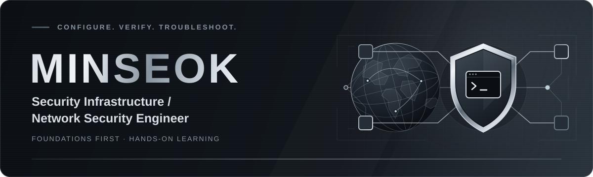

  

  <strong>보안 인프라 · 네트워크 보안 엔지니어를 준비합니다</strong> 
  Aspiring Security Infrastructure / Network Security Engineer 
  관심 분야: 보안솔루션 구축·운영 · Linux · Networking · Python

  <a href="#-about-me">About</a> &nbsp;·&nbsp;
  <a href="#-tech-stack">Stack</a> &nbsp;·&nbsp;
  <a href="#-hands-on-labs">Labs</a> &nbsp;·&nbsp;
  <a href="#-currently-learning">Learning</a> &nbsp;·&nbsp;
  <a href="#-certifications">Certifications</a> &nbsp;·&nbsp;
  <a href="#-roadmap">Roadmap</a> &nbsp;·&nbsp;
  <a href="#-links">Links</a>

---

## ◈ About Me

**한국 ICT폴리텍대학 정보보안학과**에서 공부하며, 네트워크와 시스템의 동작 원리를 익히고 있습니다.

보안 인프라와 네트워크 보안 엔지니어를 목표로 **보안솔루션 구축·운영과 문제 해결**에 관심을 두고 있습니다. 현재는 Linux, 네트워크, Python의 기초를 학습하고, Packet Tracer와 Windows 명령어로 배운 내용을 직접 확인하고 있습니다.

> 설정을 따라 하는 데서 그치지 않고, 왜 필요한지 이해하고 결과를 검증하는 연습을 하고 있습니다.

## ⌘ Tech Stack

  
  
  

  
  

Learning은 학습 중, Lab Experience는 기초 실습 경험을 뜻합니다.

## ⌁ Hands-on Labs

### 01 / 네트워크 구축과 통신 검증

**Cisco Packet Tracer · 2026.09.30 · 기초 실습 완료**

- **구성** — 라우터 3대와 스위치, PC·Server를 연결하고, IP 주소·서브넷 마스크·기본 게이트웨이를 설정했습니다.
- **라우팅** — 라우터 인터페이스를 설정·활성화하고, RIP 동적 라우팅으로 연결된 네트워크 정보를 공유하도록 구성했습니다.
- **검증** — 서로 다른 LAN의 PC 간 `ping`에 성공했고, Simulation Mode에서 ICMP 패킷이 라우터 3대를 거쳐 전달되는 것을 확인했습니다.
- **저장** — 모든 라우터에서 `copy running-config startup-config`로 설정을 저장했습니다.

라우팅의 기초 원리를 익힌 실습이며, RIPv1/RIPv2 차이와 서브넷 심화 내용은 추가 학습할 계획입니다.

<!-- 실제 실습 저장소를 공개하면 이 위치에 링크를 추가합니다. -->

### 02 / 네트워크 연결과 프로세스 확인

**Windows · 2026.10.08 · 기초 실습 완료**

- **기초 학습** — TCP/IP 4계층과 TCP·UDP의 차이를 공부했습니다.
- **연결 확인** — `netstat -ano`로 IP 주소, Port, TCP 연결 상태, PID를 확인했습니다.
- **프로세스 확인** — `tasklist /FI "PID eq 번호"`로 PID를 조회해 해당 연결을 사용하는 프로세스가 `chrome.exe`임을 확인했습니다.
- **출력 비교** — TCP의 `LISTENING`, `ESTABLISHED` 등의 상태를 살펴보고, UDP 출력에는 같은 연결 상태가 표시되지 않는 점을 확인했습니다.

**추가 진단 실습** — Windows에서 `ping`으로 응답 여부, `tracert`로 경유 홉, `arp`로 ARP 캐시의 IP–MAC 매핑을 확인하는 연습을 했습니다.

<!-- 실제 실습 저장소를 공개하면 이 위치에 링크를 추가합니다. -->

완료한 기초 실습을 정리한 내용입니다. 프로젝트 단위의 문서화와 저장소 공개는 아래 로드맵에 구분했습니다.

## ↗ Currently Learning

| 분야 | 현재 학습 내용 |
| :--- | :--- |
| Linux | 기본 명령어, 권한, 사용자 관리, 파일 시스템, 프로세스·서비스 |
| Networking | TCP/IP, IP 주소 체계, 라우팅, 진단 명령어 복습 |
| Python | 기본 문법과 프로그래밍 기초 |

세 분야 모두 학습 중이며, 실습과 복습을 병행하고 있습니다.

## ◇ Certifications

| 자격증 | 상태 |
| :--- | :--- |
| 리눅스마스터 2급 | 준비 중 |
| 네트워크관리사 2급 | 준비 중 |

## → Roadmap

- [ ] **기초 다지기 · 진행 중** — Linux·Networking·Python 학습과 자격증 준비를 이어갑니다.
- [ ] **실습 문서화 · 계획** — 토폴로지, 설정 과정, 검증 결과, 문제 해결 기록을 정리해 저장소로 공개할 예정입니다.
- [ ] **Linux 보안 설정 실습 · 계획** — 기초를 다진 뒤 시스템 보안 설정을 실습할 예정입니다.
- [ ] **보안솔루션 구축·운영 실습 · 계획** — 설치, 설정 점검, 장애 진단을 연습하는 프로젝트를 계획하고 있습니다.

## ↗ Links

  
  

---

  <strong>MINSEOK</strong> &nbsp; / &nbsp; CONFIGURE · VERIFY · TROUBLESHOOT

